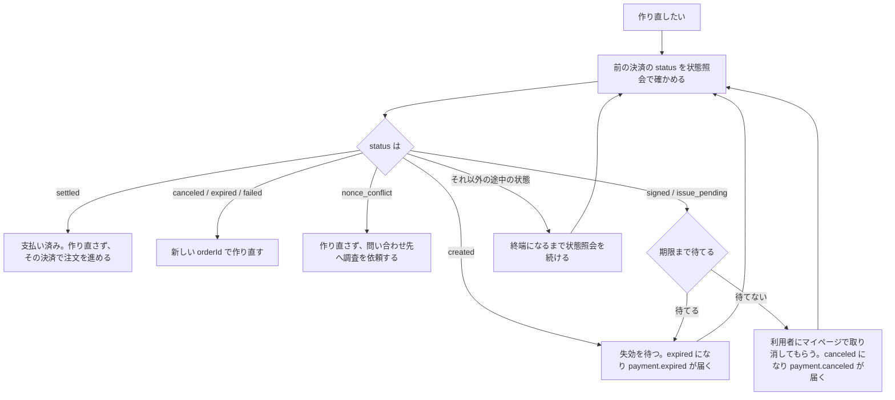

# 既存 EC への結合

注文と決済は別の状態として管理します。注文 ID、作成時に送った `orderId`、返された `paymentIntentId` の対応をサーバーへ保存してください。

## 注文への反映

| 決済の確認結果 | EC 側の扱い |
|---|---|
| 決済途中の6状態 | 入金待ち・処理中として保持 |
| `settled` | 支払い済みにし、一度だけ商品提供処理を予約 |
| `canceled` / `expired` / `failed` | 未提供なら取消・在庫解放の業務処理 |
| `nonce_conflict` | 保留し、決済 ID を添えて[問い合わせ先](/support/troubleshooting#問い合わせ先)へ調査を依頼 |

Webhook とポーリングが競合しても二重出荷しないように、注文の更新を条件付き更新にし、商品提供のジョブを同じ DB トランザクションで記録します。

## 注文と在庫の期限

EC の在庫保持期限は STBLpay の決済期限とは別です。固定の短時間で「もう成立しない」と判断せず、状態照会か Webhook で、`expired` などの終端になったかで判断してください（[操作期限と着金期限](/lifecycle/transitions#操作期限と着金期限)）。

自社注文を閉じた後でも、STBLpay の決済が終端になっていなければ成立する可能性があります。提供できない注文への着金を検出したら、運用担当者に連携します。返金する場合は、加盟店コンソールの「取引の詳細」画面から行います（[返金の提供範囲](/refunds/overview)）。

## 二重クリックと再試行

ブラウザでボタンを無効化し、サーバーは同じ注文の再試行に同じ `orderId` を使います。同じ `orderId` で作成すると、新しい決済は作られず、前の決済が返ります。

### 条件を変えて作り直すとき

金額を変えるなどで、新しい `orderId` の決済を作り直すことがあります。前の決済が終端でないうちは、利用者はまだそちらでも支払えます。その間に新しい決済を作ると、利用者が両方を払い、二重に支払うおそれがあります。加盟店から前の決済を取り消す方法はありません。そのため、作り直す前に次の順で確かめます。

1. 前の決済の `status` を、[状態照会](/server/retrieve-payment)で確かめます。
2. `settled` なら、支払いは済んでいます。作り直さず、その決済で注文を進めます。
3. `canceled`・`expired`・`failed` なら、成立しないことが確定しています。新しい `orderId` で作り直せます。
4. `nonce_conflict` なら、作り直さずに[問い合わせ先](/support/troubleshooting#問い合わせ先)へ調査を依頼します（[送金の結果が確定できない](/lifecycle/edge-cases#送金の結果が確定できないnonce_conflict)）。
5. `created`・`signed`・`issue_pending` なら、新しい決済を作りません。次の方法で終端になるのを待ち、1 に戻ります。
   - **期限を待つ**：`created` と予約開始前の `signed` は `checkoutExpiresAt` で、`issue_pending` は着金期限と確定待ちの猶予を過ぎると `expired` になり、`payment.expired` が届きます（[操作期限と着金期限](/lifecycle/transitions#操作期限と着金期限)）。
   - **利用者に取り消してもらう（`signed`・`issue_pending` のみ）**：待てない場合は、利用者に STBLpay のマイページで取り消してもらうよう案内します。取り消せるのは `signed` と、着金が確認される前の `issue_pending` だけです。取り消すと `canceled` になり、`payment.canceled` が届きます。着金が確認された後は取り消せません（[キャンセル](/lifecycle/transitions#キャンセル)）。
6. それ以外の途中の状態（着金の確認後）なら、取り消しも失効もできません。新しい決済を作らず、終端になるまで状態照会を続けて 1 に戻ります。

復帰ページの表示では、自社セッションから注文を認可します。決済 ID を知っていることだけで注文内容を返さないでください。
