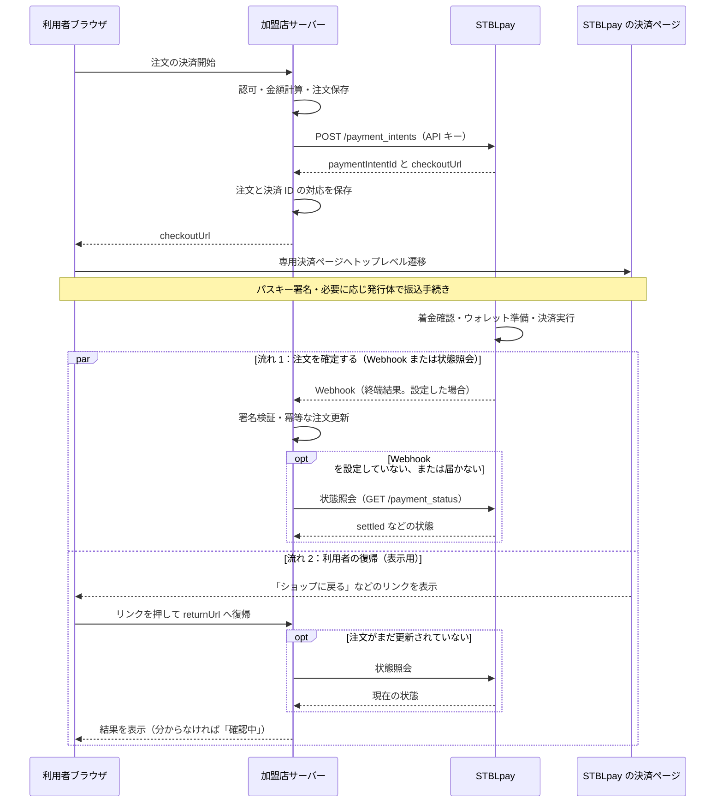

# 決済フローを理解する

加盟店サーバーが決済を作成し、利用者は専用決済ページでパスキー署名を行います。加盟店は署名処理を実装しません。

## 支払いの経路

残高が足りる場合は、`signed`（利用者の署名が済んだ）から `deposit_confirmed`（着金または残高を確認した）へ進みます。振込を伴う場合は発行体での手続き後、着金の検知と、着金が取り消されない状態になるまでの確認を経て進みます。`issue_pending` は、決済ページから予約開始の通知を STBLpay が受けたことを表します。JPYC EX での手続きが済んだかは確かめていないので、利用者が途中でやめてもこの状態になります。

必要なウォレットを作成し、決済の実行が成功した `settled` で加盟店への支払いが成立します。[状態と遷移条件](/lifecycle/transitions)を確認してください。

## 結果の受け取り

結果は 2 つの流れで加盟店に届きます。注文を確定するのは流れ 1 です。流れ 2 は、利用者の画面を元のストアに戻すためのものです。

流れ 1 では、Webhook の `payment.settled`、または加盟店のサーバーから[状態照会](/reference/rest#状態照会)して得た `settled` を根拠に注文を確定します。Webhook の設定は任意です。設定しない場合は、状態照会で `settled` を確かめてから確定してください。

Webhook は成功・失敗・取消・失効を通知します。送金の結果が確定できなかった場合（`nonce_conflict`）は Webhook が届かないため、未確定注文を[状態照会](/reference/rest#状態照会)で確かめる必要があります。ブラウザの復帰だけで商品を提供しないでください。

## 利用者がストアに戻る流れ

- 戻るリンクは、STBLpay の決済ページが表示します。リンクそのものを加盟店が作る必要はありません。戻り先（`returnUrl`）のページで注文の状態を確かめて表示する処理は、加盟店が実装します（下記）。リンクは決済が終端に着いたときだけ出て、成立したときは「ショップに戻る」、それ以外の終端（`failed`・`expired`・`canceled`・`nonce_conflict`）では「お支払い先に戻る」です。途中の状態では出ません。
- リンクの先は、決済の作成時に指定した `returnUrl` に、決済 ID を `stbl_pay_intent` クエリとして付けた URL です。`returnUrl` を指定しなかった場合は、リンクは出ません。
- 戻り先で注文がまだ更新されていなければ、状態照会で確かめます。Webhook より先に利用者が戻ることがあるためです。照会しても結果が分からない場合は、完了と表示せず「確認中」と表示してください。
- 加盟店の利用停止で決済が止まった場合は、リンクは表示されません。決済ページには「この画面を閉じて、お店のページからご注文をやり直してください。」と出ます。
