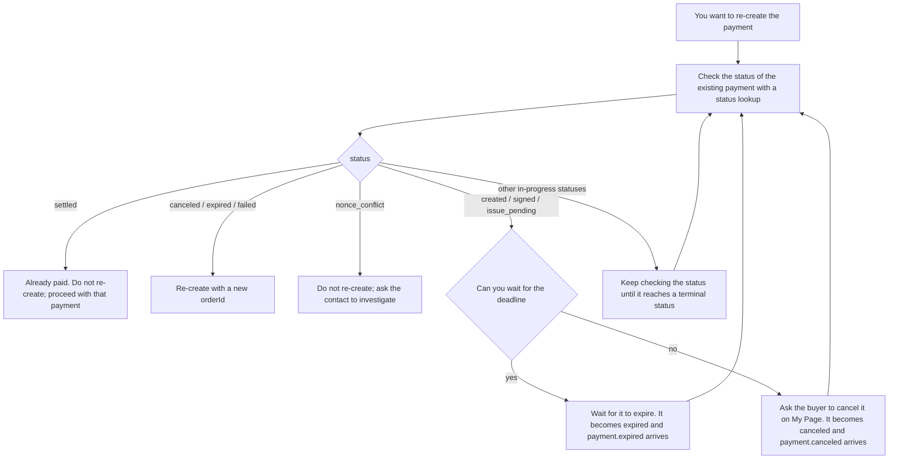

# Integrating with an existing EC site

Manage the order and the payment as separate states. Save on the server the mapping between the order ID, the `orderId` you sent at creation, and the returned `paymentIntentId`.

## Reflecting the result in the order

| Payment check result | How the EC side handles it |
|---|---|
| The 6 in-progress statuses | Hold as awaiting payment / processing |
| `settled` | Mark as paid and schedule the goods delivery process exactly once |
| `canceled` / `expired` / `failed` | If not yet delivered, run the business process for cancellation and releasing stock |
| `nonce_conflict` | Put on hold, and ask the [contact](/support/troubleshooting#contact) to investigate with the payment ID |

To avoid shipping twice when a Webhook and polling race, make the order update a conditional update and record the goods delivery job in the same database transaction.

## Order and stock deadlines

Your stock hold deadline is separate from the STBLpay payment deadline. Do not decide "it will no longer succeed" after a fixed short time. Judge by whether a status lookup or a Webhook shows a terminal status such as `expired` (see [Operation deadline and deposit deadline](/lifecycle/transitions#operation-deadline-and-deposit-deadline)).

Even after you close your own order, the STBLpay payment may still succeed if it has not reached a terminal state. If you detect a deposit for an order you cannot fulfill, escalate to an operator. To issue a refund, use the Transaction details (取引の詳細) screen in the merchant console ([Scope of refunds](/refunds/overview)).

## Double clicks and retries

Disable the button in the browser, and have the server use the same `orderId` for retries of the same order. Creating a payment with the same `orderId` does not create a new payment; it returns the existing one.

### Re-creating a payment with different conditions

You may need to create a new payment with a new `orderId`, for example to change the amount. While the existing payment is not terminal, the buyer can still pay it. If you create a new payment in the meantime, the buyer could pay both and end up paying twice. The merchant cannot cancel the existing payment. So before re-creating, check in the following order.

1. Check the `status` of the existing payment with a [status lookup](/server/retrieve-payment).
2. If it is `settled`, the payment is done. Do not re-create; proceed with the order using that payment.
3. If it is `canceled`, `expired`, or `failed`, it will definitely not succeed. You can re-create it with a new `orderId`.
4. If it is `nonce_conflict`, do not re-create; ask the [contact](/support/troubleshooting#contact) to investigate (see [The transfer result cannot be determined](/lifecycle/edge-cases#nonce-conflict)).
5. If it is `created`, `signed`, or `issue_pending`, do not create a new payment. Wait until it reaches a terminal status in one of the following ways, then go back to step 1.
   - **Wait for the deadline**: `created` and `signed` before the reservation starts expire at `checkoutExpiresAt`, and `issue_pending` expires after the deposit deadline plus the confirmation-wait grace period. The status becomes `expired` and `payment.expired` arrives (see [Operation deadline and deposit deadline](/lifecycle/transitions#operation-deadline-and-deposit-deadline)).
   - **Ask the buyer to cancel**: If you cannot wait, ask the buyer to cancel it on STBLpay's My Page (マイページ). Only `signed`, and `issue_pending` before the deposit is confirmed, can be canceled. Canceling makes the status `canceled`, and `payment.canceled` arrives. Once the deposit is confirmed, it cannot be canceled (see [Cancellation](/lifecycle/transitions#cancellation)).
6. If it is in any other in-progress status (after the deposit is confirmed), it can neither be canceled nor expire. Do not create a new payment. Keep checking the status until it reaches a terminal status, then go back to step 1.

On the return page, authorize the order from your own session. Do not return order details just because the requester knows the payment ID.
