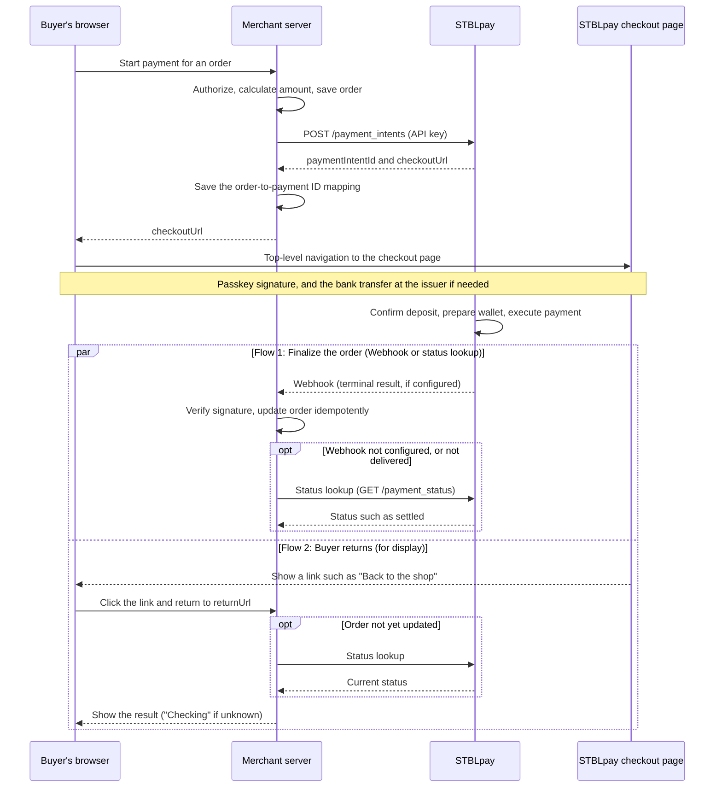

# Understand the payment flow

The merchant server creates a payment, and the buyer signs with a passkey on the dedicated checkout page. Merchants do not implement signing.

## Payment paths

If the balance is sufficient, the payment moves from `signed` (the buyer has signed) to `deposit_confirmed` (the deposit or balance has been confirmed). If a bank transfer is needed, the payment moves forward after the buyer completes the procedure at the issuer, STBLpay detects the deposit, and the deposit can no longer be reversed. `issue_pending` means STBLpay received a reservation-start notification from the checkout page. STBLpay does not verify whether the procedure at JPYC EX was completed, so the payment also enters this status if the buyer abandons midway.

The payment to the merchant succeeds at `settled`, after the required wallet is created and the payment executes successfully. See [Statuses and transition conditions](/lifecycle/transitions).

## Receiving the result

The result reaches the merchant through two flows. Flow 1 finalizes the order. Flow 2 sends the buyer back to the original store.

In flow 1, finalize the order based on the `payment.settled` Webhook, or on `settled` returned by a [status lookup](/reference/rest#retrieve-payment) from your server. Setting up a Webhook is optional. If you don't set one up, confirm `settled` with a status lookup before you finalize.

Webhooks notify success, failure, cancellation, and expiry. If the outcome of the transfer could not be determined (`nonce_conflict`), no Webhook is delivered, so you must check unfinalized orders with a [status lookup](/reference/rest#retrieve-payment). Do not deliver goods just because the buyer's browser returned.

## How the buyer returns to the store

- The STBLpay checkout page displays the return link. You don't need to build it. You do implement the page at the return destination (`returnUrl`) that checks and displays the order status (see below). The link appears only when the payment reaches a terminal state. On success it reads "Back to the shop" (ショップに戻る). In the other terminal states (`failed`, `expired`, `canceled`, `nonce_conflict`) it reads "Back to the payee" (お支払い先に戻る). It does not appear while the payment is in progress.
- The link goes to the `returnUrl` you specified when you created the payment, with the payment ID appended as the `stbl_pay_intent` query parameter. If you didn't specify `returnUrl`, no link appears.
- If the order hasn't been updated yet at the return destination, check with a status lookup. The buyer may return before the Webhook arrives. If the lookup doesn't give a result, don't show completion. Show "Checking" instead.
- If the payment stopped because the merchant was suspended, no link is shown. The checkout page shows "Close this screen and place the order again from the store's page." (この画面を閉じて、お店のページからご注文をやり直してください。)
