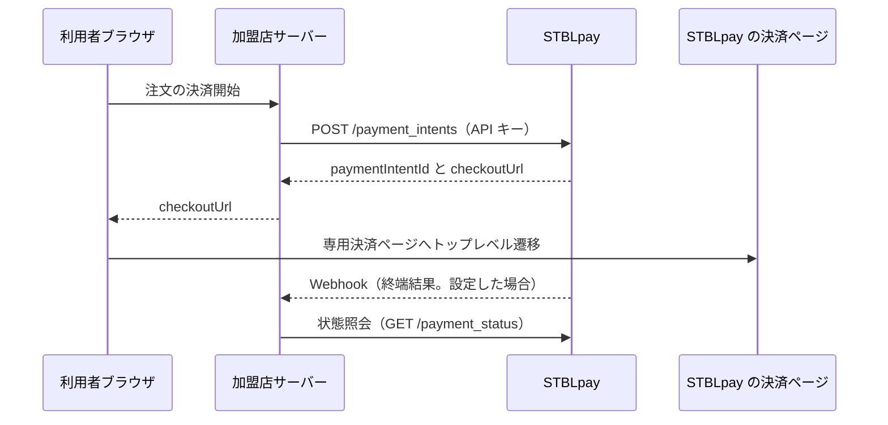

# Zenn 記事の下書き

## タイトル

円で払いステーブルコイン（JPYC）で受け取る決済を EC に組み込む：決済の作成から Webhook まで

topics 案：jpyc, 決済, webhook, nodejs, ec
type: tech

## 本文

円で払い、ステーブルコイン（JPYC）で受け取る決済「すてぶるペイ（STBLpay）」（開発中）を、EC サイトに組み込む流れを書きます。提供開始日は未定です。組み込みを試せる Sandbox と、加盟店向けドキュメント、API 仕様書（OpenAPI 3.1）は公開済みなので、それを使って確かめます。

コードは、公式ドキュメントにあるものだけを使います。細部はドキュメントと仕様書で確認してください。

- ドキュメント：https://stbl-pay.com/docs/
- API 仕様書：https://stbl-pay.com/docs/openapi.yaml

### 組み込みの全体像

加盟店がやることは 3 つです。

1. サーバーで決済を作る（`POST /payment_intents`）
2. 返ってきた `checkoutUrl` へ、購入者のブラウザを移動させる
3. サーバーで結果を受け取る（Webhook か、状態照会）

支払いの承認は、すてぶるペイの決済ページで購入者がパスキーで行います。署名の処理を加盟店が実装する必要はありません。

### 決済フロー

加盟店サーバーが決済を作成し、購入者は専用決済ページでパスキー署名を行います。



注文を確定する根拠は、Webhook の `payment.settled`、または状態照会で得た `settled` です。ブラウザの復帰だけで商品を提供してはいけません。

### 準備

Sandbox を使います。

| 対象 | URL |
|---|---|
| API のベース URL | `https://api.sandbox.stbl-pay.com` |
| 加盟店コンソール | https://merchant.sandbox.stbl-pay.com/ |

1. 加盟店コンソールの登録ページで、パスキーを使って加盟店を登録する
2. 「お店と QR コード」で、種類を「ネットショップ」にしてお店を作る
3. API キーを発行し、ドメインを登録する（EC の決済作成にはドメインの登録が必須です）

API キーはブラウザへ渡さないでください。

### 1. 決済を作る

最小の例は curl です（ドキュメントの Quick Start と同じ内容）。

```bash
curl --fail-with-body "$STBL_PAY_BACKEND/payment_intents" \
  -H "x-stbl-api-key: $STBL_PAY_API_KEY" \
  -H 'Content-Type: application/json' \
  --data '{"amountJpy":"4980","orderId":"ord_0001","returnUrl":"https://shop.example.com/orders/ord_0001/return"}'
```

アプリでは、次のように呼びます（ドキュメントの「決済を作成する」の例）。

```js
// order は認可と価格計算を済ませたサーバー側の注文。attempt はその注文の決済の試行。
const response = await fetch(`${process.env.STBL_PAY_BACKEND}/payment_intents`, {
  method: 'POST',
  headers: {
    'Content-Type': 'application/json',
    'x-stbl-api-key': process.env.STBL_PAY_API_KEY,
  },
  body: JSON.stringify({
    amountJpy: order.totalJpy, // 10進文字列
    orderId: attempt.id, // 通信の再送では同じ値
    returnUrl: `https://shop.example.com/orders/${encodeURIComponent(order.id)}/return`,
  }),
});
if (!response.ok) throw new Error(`決済作成失敗: HTTP ${response.status}`);
const payment = await response.json();
```

押さえる点は次のとおりです。

- 金額と `orderId` は、サーバーで決めます。ブラウザから受け取った金額をそのまま使いません
- 同じ `orderId` で作り直すと、新規の決済ではなく既存の決済が返ります。通信の再送では同じ値を使います
- 既存の決済が終端に着いていても、そのまま返ります。`checkoutUrl` へ移動させる前に、応答の `status` を確かめます。`settled` なら支払いは済んでいます。`failed`・`expired`・`canceled` なら、新しい `orderId` で作り直します
- `nonce_conflict` は結果が確定していません。自動の出荷と再請求を止め、問い合わせてください

注文と `paymentIntentId` の対応は、保存しておきます。

### 2. 購入者を決済ページへ移動させる

```js
// checkoutUrl は自社サーバーが STBLpay の作成応答から返した値。
window.location.assign(checkoutUrl);
```

ページ全体を移動させます。iframe や popup には入れません。

### 3. 状態を確かめる

```bash
curl --fail-with-body "$STBL_PAY_BACKEND/payment_status/$PAYMENT_INTENT_ID"
```

この API は認証不要です。`status` が `settled` なら成立です。`signed` や `deposit_confirmed` は処理の途中です。照会に失敗したことを、決済の失敗として扱わないでください。

### 4. Webhook で結果を受け取る

Webhook の設定は任意ですが、推奨されています。設定しない場合は、状態照会で `settled` を確かめてから注文を確定します。

届くイベントは次の 4 つです。

- `payment.settled`：決済が成立した。注文を一度だけ支払い済みにする
- `payment.failed`：決済が失敗した
- `payment.canceled`：利用者が取り消した
- `payment.expired`：期限が切れた

送金の結果が確定できない `nonce_conflict` は、通知されません。未確定の注文は、状態照会で確かめます。通知は再送されるので、複数回届くことがあります。

#### 署名を検証する

署名の方式は HMAC-SHA256 です。署名の対象は `"<t>.<raw body>"` のバイト列です。署名鍵（`whsec_` で始まる文字列）は、`whsec_` を含めた全体をそのまま鍵に使います。検証には、JSON をパースする前の raw body を使います。

```js
import { createHmac, timingSafeEqual } from 'node:crypto';

export function verifyStblPaySignature(rawBody, header, secret, now = Date.now()) {
  if (!Buffer.isBuffer(rawBody) || typeof header !== 'string' || !secret) return false;
  const parts = header.split(',').map((part) => part.trim());
  const timestamps = parts.filter((part) => part.startsWith('t='));
  if (timestamps.length !== 1) return false;
  const timestamp = timestamps[0].slice(2);
  if (!/^\d+$/.test(timestamp)) return false;
  const seconds = Number(timestamp);
  if (!Number.isSafeInteger(seconds) || Math.abs(Math.floor(now / 1000) - seconds) > 300) {
    return false;
  }

  const expected = createHmac('sha256', secret)
    .update(`${timestamp}.`)
    .update(rawBody)
    .digest();
  return parts.filter((part) => part.startsWith('v1=')).some((part) => {
    const signature = part.slice(3);
    if (!/^[0-9a-fA-F]{64}$/.test(signature)) return false;
    return timingSafeEqual(expected, Buffer.from(signature, 'hex'));
  });
}
```

つまずきやすい点が 3 つあります。

- 署名鍵を作り直してから 24 時間は、`v1` が複数届きます。すべて集め、どれか 1 つと一致すれば受理します
- Express では、Webhook のルートに `express.raw({ type: 'application/json' })` を使い、汎用の `express.json()` より先に登録します。`type` を指定しないと本文が Buffer にならず、検証に失敗します
- 署名鍵は、初めて送信先の URL を設定したときに一度だけ表示されます。サーバーのシークレット管理に保存してください

#### テスト通知を先に分ける

加盟店コンソールから、テスト通知を送れます。テスト通知は新しいイベント種別ではなく、本文に `test: true` が入ります。署名を検証した直後、業務処理より前に判定します。

```js
const parsed = JSON.parse(rawBody.toString('utf8')); // 署名の検証のあと
if (parsed.test === true) return res.sendStatus(200); // 注文を変えずに応答する
```

不要なキーを捨てる検証を通した後の値では判定しないでください。`test` が消えて、本物の成立通知に見えます。

#### 重複を除く

再送でも、イベントの本文と `id` は変わりません。署名検証済みの本文の `id` に UNIQUE 制約を付けて、重複を除きます。受信したイベントは先に保存し、そのあとで `2xx` を返します。業務処理は、再試行できるワーカーで行います。ドキュメントの例は次のとおりです。

```sql
CREATE TABLE stbl_pay_inbox (
  event_id TEXT PRIMARY KEY,
  payload JSONB NOT NULL,
  received_at TIMESTAMPTZ NOT NULL DEFAULT now(),
  processed_at TIMESTAMPTZ
);
```

受信の手順をまとめると、次の順です。

1. raw body の署名と時刻を検証する
2. テスト通知かどうかを判定する
3. JSON の形を検証し、未知のイベント種別は注文を変えずに無視する
4. `id` をキーにイベントを保存する
5. 保存できてから `2xx` を返す
6. 決済 ID と注文の対応を確かめ、冪等に注文を更新する

到着順は保証されません。`created_at` の大小だけで注文を上書きしないでください。

### 試すときの注意

- `returnUrl` には、`localhost` や `http://` の URL は使えません。ローカルで戻りまで試すには、トンネルなどで公開した URL のホスト名をドメインに登録します
- 復帰 URL のクエリを、支払い済みの判定に使わないでください

### まとめ

決済の作成、ページ全体の移動、サーバーでの結果の確認が、組み込みの中心です。結果の確認は、署名の検証、保存、冪等な更新の順に実装します。API の項目ごとの定義は、仕様書にあります。

すてぶるペイは開発中です。手数料は検討中で、全加盟店一律の固定料率を予定しています。購入者への上乗せはありません。提供開始日は未定です。

- サイト：https://stbl-pay.com/
- ドキュメント：https://stbl-pay.com/docs/
- Sandbox の始め方：https://stbl-pay.com/docs/testing/sandbox/

運営：合同会社暗号屋
